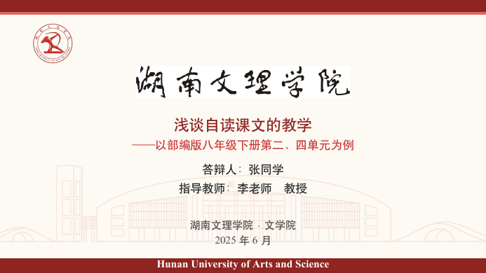
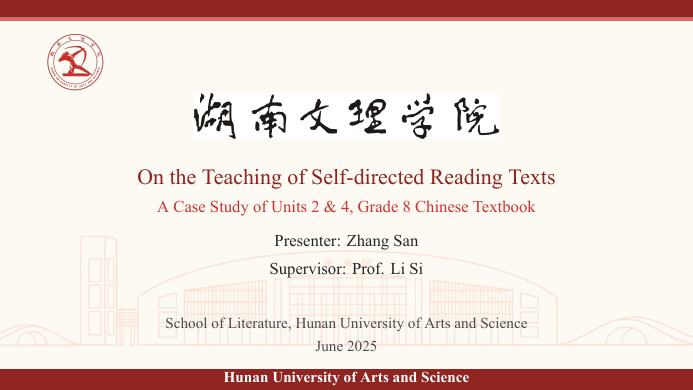
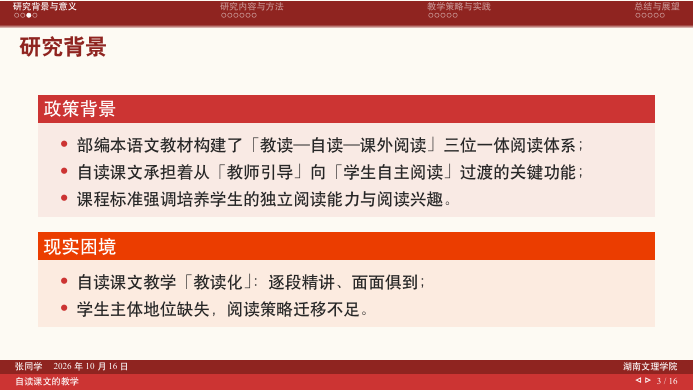

# HUAS-Beamer 湖南文理学院 Beamer 模板

<p align="center">
  <em>Hunan University of Arts and Science — LaTeX Beamer Theme</em>
</p>

湖南文理学院非官方 LaTeX Beamer 演示模板，适用于毕业答辩、开题报告、课程汇报与学术会议展示。
以校徽红 + 校旗橙红为主色（并提供冷色调蓝白版本），融合校徽、校标、图书馆/校门建筑线稿等
校园视觉元素，提供**中/英文 × 暖/冷色**共四个版本。

| 中文版封面 | 节标题页 |
| --- | --- |
|  |  |

| 英文版封面 | 内容页 |
| --- | --- |
|  |  |

## 版本矩阵

| | 暖色调（校徽红） | 冷色调（蓝白） |
| --- | --- | --- |
| **中文** | `HUAS-Beamer.tex` → [HUAS-Beamer.pdf](template/HUAS-Beamer.pdf) | `HUAS-Beamer-Blue.tex` → [HUAS-Beamer-Blue.pdf](template/HUAS-Beamer-Blue.pdf) |
| **英文** | `HUAS-Beamer-EN.tex` → [HUAS-Beamer-EN.pdf](template/HUAS-Beamer-EN.pdf) | `HUAS-Beamer-Blue-EN.tex` → [HUAS-Beamer-Blue-EN.pdf](template/HUAS-Beamer-Blue-EN.pdf) |

## 特性

- **校本视觉封面**（借鉴 HNU-Beamer-Template）：顶部/底部色带（暖=红、冷=蓝）、左上角透明校徽、
  书法校标 + 标题信息居中、底部单位与日期、底部色带中央白色加粗英文校名
- **学术字体规范**：西文与数字 Times 衬线体系（Times New Roman / TeX Gyre Termes），
  数学为 Times 风格（newtxmath）；中文正文黑体、节页标题保持宋体衬线
- **成熟版式骨架**（借鉴 thubeamer / NJIT / SJTUBeamer）：
  - 顶部 smoothbars 目录导航条（中文黑体）
  - 双行页脚：汇报人 + 汇报时间 / 单位 · 标题 + 翻页按键 + 页码
  - 节前自动「渐变节页（编号 + 标题 + 水平章节导航）+ 目录页」
- **目录页**：校门线稿背景水印、中文数字编号（一、二、三、四、）、
  节前目录「当前节及其附属小节高亮、其余灰显且不显示其小节」（NJIT 规则）
- **底部翻页按键**：白色线条三角 ◁ ▷（`[nonav]` 可关闭），显示位置与点击热区一致
- **双色调**：`[blue]` 选项整套切换冷色调（蓝白），页面底色纯白
- **全流程可调**：颜色、尺寸、图片、文字、字体均以 `★调色★/★尺寸★/★图片★/★文字★/★字号★/★行距★`
  注释就地标注（见 [自定义说明](docs/模板使用与自定义说明.md)）

## 快速开始

> 从未接触过 LaTeX？—— 请直接看下面的 [从零开始：手把手做第一份幻灯片](#从零开始手把手做第一份幻灯片)。

### 方式一：本地编译（TeX Live / MiKTeX）

```bash
cd template
make              # Linux/macOS（编译全部四版）
makebeamer.bat    # Windows 双击（同上）
```

手动编译单个版本：

```bash
xelatex HUAS-Beamer.tex
bibtex  HUAS-Beamer
xelatex HUAS-Beamer.tex
xelatex HUAS-Beamer.tex
```

### 方式二：Overleaf

上传 `template/` 全部内容 → Menu → Compiler 选 **XeLaTeX** → 编译。

### 方式三：写自己的内容

复制 `template/HUAS-Beamer.tex` 为你的文档，修改导言区六个命令即可：

```latex
\title[页脚短标题]{你的标题}
\subtitle{副标题（可删）}
\author[短名]{答辩人：XXX}
\supervisor{指导教师：XXX}          % 可删
\institute[短单位]{湖南文理学院·XX学院}
\date{\small 2025 年 6 月}
```

> 页脚信息自动读取以上命令：汇报人、标题显示方括号短标题；汇报时间默认为编译日期，
> 可用 `\reportdate{2025 年 6 月 10 日}` 固定。

## 从零开始：手把手做第一份幻灯片

> 面向完全没有 LaTeX 基础的读者：装环境 → 跑通示例 → 学会基本写法 → 改成自己的内容。
> 已熟悉 LaTeX 的读者可直接跳到「主题选项」。

### 第 1 步 · 准备环境（三选一）

| 方式 | 适合 | 操作 |
| --- | --- | --- |
| **A. Overleaf 在线**（推荐新手） | 不想装软件、快速上手 | 见下方详细步骤 |
| **B. TeX Live + TeXstudio** | 长期使用、离线写作 | 安装 [TeX Live](https://tug.org/texlive/)（Windows 全量约 4 GB，MiKTeX 亦可）+ [TeXstudio](https://www.texstudio.org/) |
| **C. VS Code + LaTeX Workshop** | 已在用 VS Code | 装好 TeX Live/MiKTeX 后安装 `LaTeX Workshop` 扩展 |

**A. Overleaf 详细步骤**：注册登录 [overleaf.com](https://www.overleaf.com) → `New Project → Upload Project`
→ 把 `template/` 目录打包成 zip 上传 → 左上角 `Menu → Compiler` 选 **XeLaTeX** → 点 `Recompile`。

**B/C. 本地要点**：本模板必须用 **XeLaTeX** 编译（支持中文与系统字体），
**不要用 pdfLaTeX**。TeXstudio 可在「选项 → 设置 TeXstudio → 命令」确认 XeLaTeX；
每个 `.tex` 文件首行的 `% !TEX program = XeLaTeX` 也在提示编辑器使用 XeLaTeX。

### 第 2 步 · 跑通示例

```bash
cd template
xelatex HUAS-Beamer.tex    # 第一次编译（可先不管参考文献）
```

执行完会生成 `HUAS-Beamer.pdf`，打开确认效果与 [template/HUAS-Beamer.pdf](template/HUAS-Beamer.pdf) 一致，
说明环境没问题。Windows 也可直接双击 `makebeamer.bat` 一次编译全部四版。

### 第 3 步 · 认识文档骨架

一篇 Beamer 就是一个 `.tex` 文本文件，结构如下：

```latex
\documentclass[aspectratio=169]{beamer}  % 16:9 幻灯片（4:3 则去掉该选项）
\graphicspath{{figures/}}               % 图片素材都在 figures/ 里找
\usepackage{huasbeamer}                 % 加载 HUAS 主题（可加 [blue] 等选项）

% ===== 导言区：填写你的封面信息 =====
\title[页脚短标题]{封面标题}
\subtitle{副标题（可删）}
\author[短名]{答辩人：XXX}
\supervisor{指导教师：XXX}              % 可删
\institute[短单位]{湖南文理学院·XX学院}
\date{\small 2025 年 6 月}

\begin{document}
\begin{frame}[plain,noframenumbering]
  \titlepage                           % 封面页
\end{frame}

\section{第一章标题}                    % 章：自动出「渐变节页 + 目录页」
\subsection{小节标题}                   % 小节：目录里显示在章下
\begin{frame}{这一页的标题}             % 一个 frame = 一页幻灯片
  这里写正文……
\end{frame}
\end{document}
```

**记忆口诀**：`\section` 是章、`\subsection` 是节、`\begin{frame}{标题}` 是页。
页面顺序 = `frame` 出现顺序；封面、目录、参考文献、致谢各是一个特殊 frame（见示例）。

### 第 4 步 · 常用写法速成

| 想写什么 | 怎么写 |
| --- | --- |
| 无序列表 | `\begin{itemize} \item 第一点 \item 第二点 \end{itemize}` |
| 有序列表 | `\begin{enumerate} \item … \end{enumerate}` |
| 词条解释 | `\begin{description} \item[导入] 说明…… \end{description}` |
| 强调区块 | `\begin{block}{标题}内容\end{block}`；警告用 `alertblock`，示例用 `exampleblock` |
| 左右双栏 | `\begin{columns}[T] \begin{column}{0.48\textwidth}…\end{column} \begin{column}{0.48\textwidth}…\end{column} \end{columns}` |
| 插图 | `\includegraphics[width=0.5\textwidth]{图片名}`（图片放 `figures/`，勿写扩展名） |
| 表格 | `tabular` 环境；表头用模板自带的 `\huastableheader` + `\huastableheaderfont`（彩色表头） |
| 公式 | 行内 `$E=mc^2$`；编号用 `\begin{equation} … \end{equation}` |
| 引用文献 | 正文 `\cite{wang2019}`，条目写在 `reference.bib`，文末 frame 加 `\bibliographystyle{plain}\bibliography{reference}` |
| 代码 | `\begin{lstlisting}[language=Python] … \end{lstlisting}`，**该 frame 必须加 `[fragile]`** |
| 分步显示 | `\begin{itemize}[<+-| alert@+>] \item …`：逐条出现并高亮当前条 |

### 第 5 步 · 把示例改成你的内容

1. 复制 `template/HUAS-Beamer.tex` 为你的文件名（如 `我的答辩.tex`）；
2. 改导言区六个命令（`★内容填写★` 注释处）；
3. 按「章 → 节 → 页」的骨架替换正文：示例里的列表/表格/公式都是范例，整段换成你的文字即可；
4. 不需要的 frame（如代码示例页）整段删除；
5. 重新编译查看效果。

### 第 6 步 · 编译、排错与改样式

- **含参考文献时四步编译**：`xelatex → bibtex → xelatex → xelatex`（缺一步会出现 `[?]`）；
- **排错**：出错时看终端**第一个** `!` 开头的错误；行号在 `.log` 里最准；
- **改样式**（颜色/尺寸/字体/图片）：`huasbeamer.sty` 中所有可调点均以
  `★调色★ / ★尺寸★ / ★图片★ / ★文字★ / ★字号★ / ★行距★` 注释标注，
  逐项对照表见 [docs/模板使用与自定义说明.md](docs/模板使用与自定义说明.md)；
- **常见报错**先查下方「常见问题」表。

## 主题选项

```latex
\usepackage{huasbeamer}                % 中文暖色调（默认）
\usepackage[blue]{huasbeamer}          % 冷色调（蓝白）
\usepackage[en]{huasbeamer}            % 英文模式
\usepackage[notoc]{huasbeamer}         % 关闭节前自动「节页+目录页」
\usepackage[subsectiontoc]{huasbeamer} % 小节前也出目录页
\usepackage[nonav]{huasbeamer}         % 关闭底部翻页按键
```

选项可组合，例如 `\usepackage[blue,en]{huasbeamer}`。

## 目录结构

```
HUAS-Beamer/
├─ README.md                  # 本文件
├─ LICENSE                    # MIT 协议 + 素材版权附注
├─ .gitignore
├─ template/                  # ★ 正式模板包
│  ├─ huasbeamer.sty          # 主题样式（★注释化可调★）
│  ├─ HUAS-Beamer.tex         # 中文演示（暖色调）
│  ├─ HUAS-Beamer-EN.tex      # 英文演示（暖色调）
│  ├─ HUAS-Beamer-Blue.tex    # 中文演示（冷色调蓝白）
│  ├─ HUAS-Beamer-Blue-EN.tex # 英文演示（冷色调蓝白）
│  ├─ reference.bib           # 参考文献示例
│  ├─ figures/                # 校徽、校标、建筑线稿素材
│  ├─ Makefile / makebeamer.bat / .latexmkrc
│  └─ HUAS-Beamer*.pdf        # 四版编译成品
├─ docs/
│  ├─ 开发计划.md              # 调研分析、视觉规范、技术方案、开发规范
│  ├─ 模板使用与自定义说明.md   # ★ 全部可调整项速查
│  └─ images/                 # README 预览图
├─ examples/                  # 调研参考模板（清华/南工程/厦大/湖大/武大/川大/上交等）
└─ research/                  # 学校视觉素材（校徽/校旗/建筑线稿/校训等）
```

## 自定义

**所有可调整项**（内容填写、颜色、尺寸、图片、文字、字体）详见
**[docs/模板使用与自定义说明.md](docs/模板使用与自定义说明.md)**；
样式文件 `huasbeamer.sty` 内亦以 `★调色★ / ★尺寸★ / ★图片★ / ★文字★ / ★字号★ / ★行距★`
注释标注每个配置点。

常用快捷对照：

| 想改什么 | 改哪里 |
| --- | --- |
| 页面底色（暖版偏黄深浅 / 蓝版纯白） | 搜 `\definecolor{huasbg}` |
| 封面顶/底色带 | 搜 `0.40cm` / `0.48cm`（色带高度） |
| 封面左上角校徽 | 搜 `huas-badge-v2` |
| 底部色带英文校名 | 搜 `\huas@nameen` |
| 全局行距 / 列表 / 表格行距 | 搜 `行距与列表间距` |
| 翻页按键样式 | 搜 `\huas@navsymbols` |
| 目录编号（中文数字） | 搜 `\huas@cnnum` |
| 中文黑体 / 西文 Times | 搜 `★字体★` |
| 校训文字（保留定义、默认不显示） | 搜 `\huas@motto` |

## 常见问题

| 问题 | 解决办法 |
| --- | --- |
| 代码页 `lstlisting` 报错 | 该 frame 加 `[fragile]`：`\begin{frame}[fragile]{标题}` |
| 参考文献显示 `[?]` | 按 `xelatex → bibtex → xelatex → xelatex` 四步编译 |
| 封面/目录装饰位置偏移一次 | TikZ `remember picture` 需两轮编译，属正常现象 |
| 中文字体缺失 | 默认 TeX Live 自带 fandol；Windows 可改 `fontset=windows`（见自定义说明） |
| 英文版需全英文编译 | 用 `\usepackage[en]{huasbeamer}`（不加载 ctex） |
| PDF 被占用无法覆盖编译 | 关闭正在预览该 PDF 的阅读器后重新编译 |

## 命名规范（自 v1.8 起）

文档与代码采用 `HUAS-Beamer` 体系命名（不再使用 `demo-*` 旧名）：

| 现名 | 旧名 |
| --- | --- |
| `HUAS-Beamer.tex` | `demo-cn.tex` |
| `HUAS-Beamer-EN.tex` | `demo-en.tex` |
| `HUAS-Beamer-Blue.tex` | `demo-blue.tex` |
| `HUAS-Beamer-Blue-EN.tex` | `demo-blue-en.tex` |

## 致谢

本模板在以下优秀高校 Beamer 模板基础上调研融合而成，谨致谢意：

- [thubeamer](https://github.com/YangLaTeX/thubeamer)（清华大学）—— 版式骨架、页脚与目录页设计
- NJIT_LaTeX_Template（南京工程学院）—— 单文件样式结构、校徽主题色、目录高亮规则
- Xiamen University-Red（厦门大学）—— 演示文档组织与底部导航控件
- [HNU-Beamer-Template](https://github.com/zyh-hnu/HNU-Beamer-Template)（湖南大学）—— 封面色带布局、导师命令、表格辅助宏、构建脚本
- [WHU-Beamer](https://github.com/hrtan99/WHU-Beamer)（武汉大学）—— 工程组织与文档结构
- [SCU-Beamer-Theme](https://github.com/FvNCCR228/SCU-Beamer-Theme)（四川大学）—— latexmk 工程化配置、字体方案
- [SJTUBeamer](https://github.com/sjtug/SJTUBeamer)（上海交通大学）—— 节页两行式结构与章节导航、professionalfonts

## 协议

代码采用 [MIT License](LICENSE)；校徽、校名等视觉素材版权归湖南文理学院所有，
仅用于学习与模板演示。本模板为社区作品，非学校官方发布。
